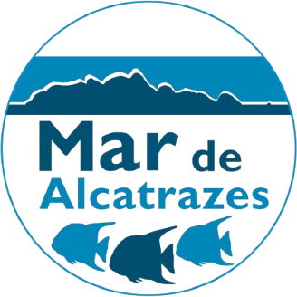
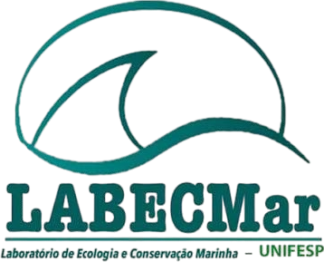

  
  &nbsp;&nbsp;&nbsp;
  
  <h1>Mar de Alcatrazes - LABECMar</h1>

  
  
  
  
  

Site institucional do projeto **Mar de Alcatrazes**, do **Laboratório de Ecologia e Conservação Marinha (LABECMar/UNIFESP)**, com cinco anos de monitoramento de invertebrados, peixes e fatores abióticos no Arquipélago dos Alcatrazes, litoral norte de São Paulo.

---

## 🔗 Link do Projeto

- **Produção:** [https://labecmar.com](https://labecmar.com)
- **Repositório:** [github.com/annajsussai/prototipo-projeto-alcatrazes](https://github.com/annajsussai/prototipo-projeto-alcatrazes)

---

## 📃 Resumo do Projeto

Site de página única, em HTML, CSS e JavaScript puro, que apresenta a pesquisa e reúne os principais produtos do projeto: a reportagem-síntese, o documentário e o livro. Foi pensado para estudantes, educadores e apoiadores da conservação dos oceanos.

**Seções:**
- **Sobre o projeto** — apresentação da pesquisa e do selo Blue Park / Hope Spot
- **Arquipélago** — Alcatrazes, o "Lugar de Aves", e sua biodiversidade
- **Frentes de pesquisa** — fatores abióticos, peixes, comunidades bentônicas e espécies exóticas
- **Métodos** — BRUV, telemetria acústica, censos visuais, satélite e sensores
- **História** — da mira dos canhões à proteção integral
- **Reportagem, Filme e Livro** — os produtos do projeto

---

<!--

  

Para ativar, grave um GIF do leitor do livro, salve em ./images/ e remova as marcas de comentário.

---
-->

## 🐱‍💻 Funcionalidades Principais

- **Leitor de livro com virada de página** — o PDF é renderizado no navegador, com animação de página, setas do teclado, gesto de deslizar no celular e modo tela cheia
- **Visualizador de reserva** — se o leitor falhar, o PDF é exibido por um visualizador alternativo
- **Documentário sob demanda** — o vídeo só carrega quando a pessoa clica em "Assistir ao documentário"
- **Reportagem-síntese** — visualização incorporada, com opções de abrir em tela cheia e baixar o PDF
- **Animações de texto** — entrada em sequência no topo e aparecimento gradual ao rolar a página
- **Tema claro e escuro** — acompanha a preferência do sistema do visitante
- **Menu responsivo** — menu hambúrguer no celular, que fecha com a tecla Esc

---

## 🛠️ Tecnologias Utilizadas

### Base
- **HTML5** — estrutura semântica da página
- **CSS3** — layout responsivo, variáveis CSS e tema claro/escuro
- **JavaScript (Vanilla)** — menu, animações e carregamento do filme e do livro

### Bibliotecas
- **PDF.js** (3.11.174) — renderização do PDF do livro no navegador
- **StPageFlip** (page-flip 2.0.7) — efeito de virada de página
- **Google Fonts** — tipografia (Fraunces e Inter)

---

## 🎨 Design & UX/UI

### Identidade Visual
- Paleta em azul-marinho e azul-petróleo, com laranja queimado como cor de destaque
- Títulos em **Fraunces** (serifada) e textos em **Inter**
- Fotografias de campo como elemento central, com créditos ao fotógrafo

### Layout & Responsividade
- Página única com navegação por âncoras entre as seções
- Layout em colunas que se reorganiza para telas pequenas
- Leitor do livro adaptado ao formato paisagem da publicação

### Interações
- Barra de rolagem personalizada, com trilho branco e rolagem na cor do projeto
- Animações suaves de entrada, sem desfoque nem movimentos bruscos
- Leitor do livro com virada de página, setas do teclado e gesto de deslizar

### Acessibilidade
- Link "Pular para o conteúdo" no início da página
- Respeita a preferência "reduzir movimento" do sistema
- Rótulos ARIA, textos para leitores de tela e foco visível
- Conteúdo legível sem JavaScript e na impressão

---

*Site desenvolvido para o projeto Mar de Alcatrazes, LABECMar/UNIFESP - Santos, SP (2026).*
